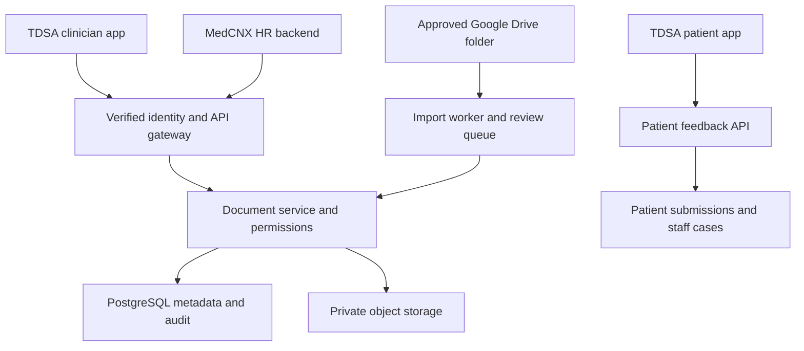

# Connecting the TDSA document hub

**11 October 2026 · Rebuild 0.4 · Implementation handoff**

The rebuilt hub is a working local preview on `feat/medical-document-hub`. It is not connected to the official TDSA apps, MedCNX, Drive or Cloud SQL. Its fixed demo identity is not a production login. The production startup guard remains enabled. This guide distinguishes the working routes from the integrations still to implement.

## What works now

- Folder and subfolder explorer; medical folder setup; multi-file and drag-and-drop uploads; drag to move files, source documents and folders.
- PDF, UTF-8 TXT and standard DOCX uploads, up to 4 MiB each. DOCX previews show extracted text rather than original Word layout.
- Metadata search, category/access filters, list/grid views, sorting, bulk move/archive/restore, immutable file versions and audit events.
- Medical categories, document types, tags, next review date and metadata review with revision conflict checks. A new file version resets metadata review.
- Local classification suggestions. TXT uses its text; DOCX analysis extracts document text; PDF analysis uses `pdftotext` when installed, otherwise filename-only suggestions. Scanned PDFs need a future OCR provider. No document content is sent to a cloud AI provider.
- Optional AES-256-GCM protection for stored document bytes; restricted permission checks at the service layer.
- Separate patient feedback entry and staff feedback management. Local identities are synthetic.

## Recommended integration shape

Keep one authoritative document service. Each application talks to its API using verified identity. Share references and explicitly authorised document versions, rather than allowing every application to query every database table.



The patient app must not receive document-explorer or HR permissions. The feedback service can share infrastructure with the hub but needs independently enforced patient ownership and staff case-management permissions.

## 1. Details to obtain from the CTO

| Detail | Why it is needed |
| --- | --- |
| Clinician and patient app framework/backend and integration owner | Decide whether to reuse UI or expose APIs through the existing backend |
| Identity provider, token issuer/audience or server session mechanism | Verify identity on the server, handle expiry/revocation and implement logout |
| Organisation, facility, clinician, patient and encounter IDs | Establish trustworthy ownership and membership; reject IDs supplied without verification |
| Existing PostgreSQL/Cloud SQL instance, region and permitted service accounts | Decide the hosting and network connection without affecting existing workloads |
| Clinical document owner and policy approvers | Define publication, access rules, review deadlines and retention |
| MedCNX authentication and organisation/employee ID mapping | Link staff documents while keeping payroll and clinical records separated |
| Approved Drive folder ID and access owner | Limit imports to authorised files and define revision/deletion handling |

Request configuration names and architecture details. Supply passwords, keys and tokens through the approved secret store, not email, chat, source code or this document.

## 2. Database and file storage

**The hub does not have to use the same database as the clinician/patient app.** Proposed default: a dedicated `tdsa_documents` database on an approved Cloud SQL PostgreSQL instance, plus private object storage for file contents. A shared instance can hold separate databases, but capacity, service identities, access and backup requirements must be reviewed. A separate instance is also possible when operational isolation is required. Do not assume the blog CMS or ECG instance is the correct target.

This repository currently uses Node SQLite and database blobs. Setting `DATABASE_URL` alone will not migrate it: a PostgreSQL repository implementation and private object-storage adapter still need to replace the SQLite operations in `store.js`, `explorer.js`, `hub.js`, `ingest.js` and the backup routes.

Migration sequence:

1. Provision the document database, a database user restricted to that database, a private file bucket and separate runtime/import service identities.
2. Implement and review versioned PostgreSQL migrations for folders, documents, file versions, metadata, approvals, access grants, import jobs, audit and external references. Include organisation/facility ownership on every relevant row, including imported sources. The existing local source catalogue is a single-workspace pilot, not a multi-tenant source repository.
3. Connect the runtime through an approved Cloud SQL connection method. With Cloud Run, configure its service account and Cloud SQL connection; grant Cloud SQL Client as required. IAM connection permission does not replace database user privileges.
4. Implement the storage adapter: private upload, scanning/quarantine, hashes, immutable object versions, authorised download and short-lived signed access where appropriate. Never expose a bucket publicly.
5. Export the local workspace and migrate its file bytes, hashes, immutable versions, metadata and audit events. Reconcile counts and hash every migrated object. Never commit the SQLite database, original documents or export records to Git.
6. Test a restored backup, access isolation, concurrent edits, failed upload recovery and clinician/patient/HR flows in staging. Enable production only after replacing the fixed identity and meeting acceptance checks.

Google reference: [Connect Cloud Run to Cloud SQL PostgreSQL](https://docs.cloud.google.com/sql/docs/postgres/connect-run).

## 3. Clinician app

1. Add a **Documents** entry in the clinician app. Reuse the UI components only after confirming the app framework; this preview uses browser JavaScript, not React.
2. Implement a same-origin backend gateway, for example `/documents/api/*`. Verify the app session or token and resolve the authoritative user and facility on the server. Do not trust browser-supplied permission arrays, user IDs or facility IDs.
3. Replace the hardcoded `clinicianActor`, `patientActor` and route-selected identities in `src/server.js` with the verified identity adapter. Define `documents.read`, `documents.manage`, `documents.restricted`, publication and approval permissions with the CTO. The current pilot grants its demo clinician broad test permissions.
4. Enforce ownership and permissions on list, metadata, classification, version, download, preview, move, archive and backup operations. Confirm access again before issuing a download URL.
5. Preserve CSRF/session protections for cookie authentication. Define strict approved origins if cross-origin API access is truly required. Do not fix integration by broadly disabling CORS or request protections. The current preview intentionally rejects external API origins and iframe embedding.
6. Link completed clinical forms to verified patient/encounter context through the owning clinical backend. Consent attestation, signatures, approved template versions and final snapshots need clinical review and implementation before clinical use.

## 4. Patient app

1. Integrate only the feedback definition and own-record operations under `/api/patient/*` (current UI `/patient`).
2. Verify the logged-in patient, resolve their facility/record ownership, and return only that patient's submissions. The current fixed patient actor must be replaced.
3. Preserve server-side anonymous feedback handling. The prototype excludes name/contact fields for anonymous feedback; production must define identity/retention policy rather than treating this as guaranteed anonymity.
4. Route submitted feedback to authorised case-management staff. Restrict staff notes and assignments to staff endpoints; keep them out of patient responses.
5. Verify that patients cannot list or fetch clinician documents, classify a file, use bulk actions, manage cases, download backups or access HR documents—even when an ID or URL is known.

## 5. MedCNX HR system

1. Agree the first use case: shared staff policies and SOP acknowledgements are a sensible starting scope. Contracts, payslips, identity documents and patient files require separate access policies.
2. Map MedCNX organisation/employee IDs to verified hub subjects through the HR backend. Store external references as `(system, organisation_id, entity_type, external_id)`; do not assume an HR employee ID is a clinician ID.
3. Let MedCNX request only the document/version references its user is authorised to see. Keep payroll calculations, employee records and clinical data in their authoritative systems.
4. Implement explicit grants for a document/version, subject and permission. Enforce a maximum classification and organisation/facility scope for each service identity.
5. When acknowledgement is added, record employee, document ID, exact immutable version/hash, acknowledgement time and evidence. A revised policy needs a new acknowledgement; metadata review in this build is not employee acknowledgement or clinical approval.
6. If events are needed, implement a transactional outbox and a signed receiver with replay protection, idempotency keys and retry reconciliation. Proposed events are `document.version_added`, `document.published` and `document.access_revoked`. They are not currently emitted as webhooks.

Do not connect MedCNX directly to the clinician/patient production tables or copy its complete employee database into this module.

## 6. Google Drive auto-import

This is a worker integration to implement, not an active connection in the preview.

1. Select one approved folder. Grant a dedicated identity only the required Drive access, subject to Workspace policies. Decide whether descendant folders, shared-drive items and Google-native exports are supported.
2. Capture a changes start token and persist it. Perform the initial folder inventory and catch up from the token so changes during the inventory are reconciled.
3. Register an authenticated HTTPS notification channel for the change feed. Notifications signal a change; fetch the actual changes through the Drive API. Do not rely on watching a folder alone to deliver the complete contents of every new or updated child document.
4. Validate channel ID, resource ID and your secret channel token; enqueue work, acknowledge quickly and process outside the HTTP request. Renew channels before expiry and run periodic reconciliation for missed notifications.
5. Fetch current metadata and permissions, confirm the file is still in the approved folder scope, validate supported type/size, download or export, scan/quarantine and compute its hash.
6. Deduplicate using the Drive file ID and version/content hash. An update adds an immutable hub version rather than overwriting an old one. Advance the cursor only after durable handling of the page; use retry-safe jobs.
7. Put new files in the review queue. Handle removals, moves and lost access explicitly: suspend sharing according to policy; do not silently destroy historical clinical or HR records.

Google references: [Retrieve changes](https://developers.google.com/workspace/drive/api/guides/manage-changes) and [Push notifications and channel renewal](https://developers.google.com/workspace/drive/api/guides/push).

## 7. AI and OCR

Current provider is `local-rules`. It reads bounded text and suggests a category/type without changing permissions or approving content. PDF text extraction requires Poppler's `pdftotext`; on a machine without it the result clearly falls back to filename-only analysis. Scans do not receive OCR in this build.

For cloud classification, implement a provider behind the same suggestion workflow. Choose its model and OCR service only after reviewing the organisation's permitted services, region, data processing terms and document sensitivity. Keep secrets on the backend. Treat document text as untrusted data: the provider returns a validated category/type/evidence object, has no tool or permission-changing access, and cannot auto-publish. Exclude restricted patient/staff documents unless their processing is explicitly authorised. Add rate limits, bounded page/text processing, queued jobs, retries and provider audit before live use.

## 8. Encryption and backups

To enable local document byte encryption before import, generate a random 32-byte key and store its canonical base64 value as `TDSA_BLOB_KEY_B64` in `.env` or the secret environment. Example command to generate a new key:

```powershell
node -e "console.log(require('node:crypto').randomBytes(32).toString('base64'))"
```

Keep the key private and backed up separately. It is never returned to the browser. Restarting with a missing or incorrect key fails when encrypted blobs exist. Encryption binds each blob to its content hash and verifies integrity on retrieval. Enabling a key encrypts existing blob rows transactionally, but old backups, WAL pages or disk remnants may still contain previous plaintext. Start with a fresh workspace for sensitive material; do not claim that startup encryption sanitises old storage.

Encryption covers **file contents only**, not filenames, tags, form records, patient feedback, audit or the entire SQLite backup. Downloaded SQLite backups may contain unencrypted sensitive metadata and require the original key for encrypted document contents. The restore command checks the key and contents before replacing the current workspace. A wrong/missing key must not be bypassed by generating another one. Key rotation and KMS envelope encryption are future production work.

Restricted access is an application permission, not a per-document password. Production needs verified identity, secure transport, encrypted infrastructure, private object access and an approved managed-key/rotation strategy. Do not use this demo for live sensitive records.

## Implemented API additions

All mutation examples use JSON and the CSRF token from the **local** `/api/session`. That session is not suitable for authenticating another system.

| Method | Route | Behaviour |
| --- | --- | --- |
| GET | `/api/hub` | Medical taxonomy, local provider/encryption scope and honest connection status |
| POST | `/api/hub/folders` | Idempotent medical folder setup |
| POST | `/api/hub/bulk` | Atomic move/archive/restore of 1–100 distinct file IDs |
| GET | `/api/hub/activity` | Latest 50 document/folder audit events for the facility |
| GET | `/api/files/:id/metadata` | Metadata and suggestion within authorised scope |
| PUT | `/api/files/:id/metadata` | Revision-checked metadata update |
| POST | `/api/files/:id/classify` | Bounded text extraction and local suggestion |

Bulk request:

```json
{"ids":["FILE_UUID"],"action":"move","folderId":"FOLDER_UUID"}
```

Metadata request:

```json
{
  "revision": 1,
  "category": "consent",
  "document_type": "Consent",
  "confidentiality": "internal",
  "review_status": "reviewed",
  "tags": ["vmmc"],
  "review_date": "2027-01-01"
}
```

`reviewed` means staff reviewed the metadata. It does not grant access, approve clinical use, publish a policy or indicate a signature. Classification suggestions do not alter the authoritative category until saved by a user.

## Acceptance before linking live systems

The CTO/integration owner should demonstrate clinician sign-in and revocation; facility isolation; restricted list/preview/version/download denial; patient own-record isolation; staff case access; HR subject mapping and denied cross-system records; immutable publication and acknowledgement versioning; Drive revision/retry/removal handling; file scanning; migrations; restore with keys; and monitoring that avoids sensitive content in logs. Keep the production guard until these flows pass in staging.
